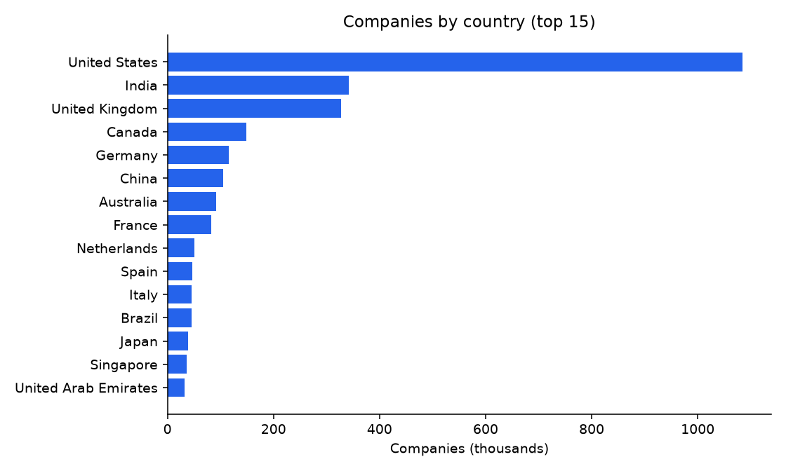
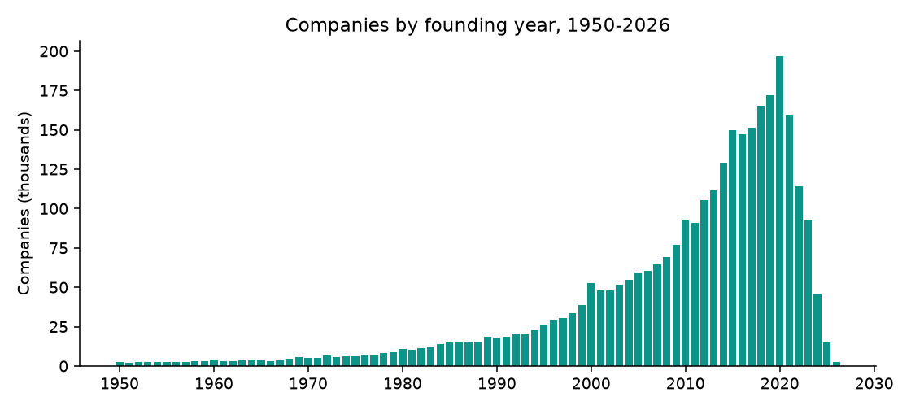
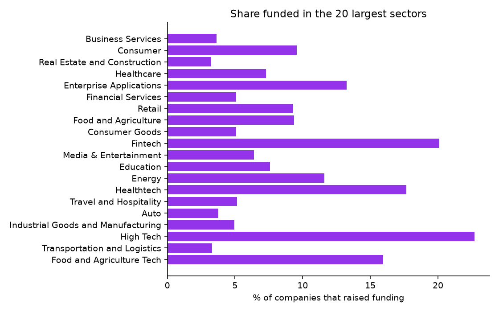

# Open Company Database (5M companies, 2026): findings, method and data card

*Fliar Research · released October 2026 · licence CC BY-NC 4.0*

**How this dataset was acquired.** Every row comes from the [Radar API](https://github.com/fliarbi/radar-api-mcp), Fliar's company-data API and MCP server. Radar builds
its company database by merging public company registries, company websites, business news and job postings into one record per company,
keyed by the company's website domain. Each record is classified into a sector, industry and business model by Radar's own models and
carries headquarters location, founding year, funding status and size. This release keeps the firmographic core of the five million
companies that have both a name and a website: one row per domain, with country names normalised and founding years checked. The full
records, with financials, funding, people and technology, are available through `POST /v1/companies/profile`
([reference](https://github.com/fliarbi/radar-api-mcp/blob/main/docs/reference/get_company.md)) or the `get_company` MCP tool.

> **This file is a 2% sample: 100,000 of 4,863,273 companies.** It keeps every record for a fixed subset of domains.
> The subset is chosen by a hash, so it stays the same from one release to the next. The findings and tables below were computed
> on the **full** data. For the rest, the withheld fields and monthly updates, [get a Radar API key](https://fliarbi.com/radar-api/developer) ([docs](https://github.com/fliarbi/radar-api-mcp)).
> Each row's `fliar_profile_url` opens the company's full profile on Fliar.

## Key findings

1. **4,863,273 companies with a working website.** 3,233,643 (66%) have a known country, spread over 228 countries; 65% have a founding year.
2. **The United States holds 34% of companies with a known country**, followed by India (10.6%), United Kingdom (10.1%), Canada (4.6%), Germany (3.6%).
3. **A young population.** The median founding year is 2013; 45% of dated companies were founded in 2015 or later and 80% in 2000 or later.
4. **9.0% have raised outside funding.** 35% are recorded as unfunded, 7.4% as acquired, 1.7% as public and 8.4% as closed.
5. **Business Services is the largest sector** (16% of classified companies), ahead of Consumer and Real Estate and Construction.
6. **Funding is concentrated in tech sectors.** Life Sciences (38%), High Tech (23%), Fintech (20%) have the highest funded shares among the 30 largest sectors, against 9% overall.

### Companies by country (top 50)

Full data. Shares are of companies with a known country.

| #   | Country              | Companies   | Share   | Median founded   | Founded 2015+   | Funded   | Closed   | Site in global top 1M   | Top sector              | Top city         |
|:----|:---------------------|:------------|:--------|:-----------------|:----------------|:---------|:---------|:------------------------|:------------------------|:-----------------|
| 1   | United States        | 1,084,480   | 33.5%   | 2010             | 36.2%           | 14.7%    | 9.1%     | 2.9%                    | Business Services       | New York         |
| 2   | India                | 341,771     | 10.6%   | 2016             | 59.2%           | 8.5%     | 17.1%    | 3.4%                    | Business Services       | Bengaluru        |
| 3   | United Kingdom       | 326,846     | 10.1%   | 2013             | 42.8%           | 10.3%    | 10.9%    | 2.5%                    | Business Services       | London           |
| 4   | Canada               | 148,169     | 4.6%    | 2013             | 45.4%           | 11.2%    | 10.9%    | 2.0%                    | Business Services       | Toronto          |
| 5   | Germany              | 115,594     | 3.6%    | 2012             | 40.5%           | 14.2%    | 7.1%     | 3.8%                    | Business Services       | Berlin           |
| 6   | China                | 105,318     | 3.3%    | 2014             | 44.9%           | 24.9%    | 20.3%    | 1.6%                    | Business Services       | Hong Kong        |
| 7   | Australia            | 92,114      | 2.8%    | 2013             | 45.5%           | 8.9%     | 13.6%    | 2.3%                    | Business Services       | Sydney           |
| 8   | France               | 82,246      | 2.5%    | 2013             | 42.6%           | 19.5%    | 10.9%    | 5.2%                    | Business Services       | Paris            |
| 9   | Netherlands          | 50,598      | 1.6%    | 2014             | 46.1%           | 13.8%    | 10.4%    | 3.5%                    | Business Services       | Amsterdam        |
| 10  | Spain                | 47,205      | 1.5%    | 2014             | 47.9%           | 17.0%    | 12.2%    | 4.9%                    | Business Services       | Madrid           |
| 11  | Italy                | 45,647      | 1.4%    | 2013             | 42.7%           | 14.1%    | 9.6%     | 4.9%                    | Business Services       | Milan            |
| 12  | Brazil               | 45,189      | 1.4%    | 2015             | 50.5%           | 11.1%    | 15.3%    | 6.0%                    | Business Services       | São Paulo        |
| 13  | Japan                | 38,831      | 1.2%    | 2013             | 44.4%           | 18.5%    | 6.6%     | 8.7%                    | Business Services       | Tokyo            |
| 14  | Singapore            | 35,696      | 1.1%    | 2016             | 61.1%           | 14.7%    | 19.9%    | 2.1%                    | Business Services       | Singapore        |
| 15  | United Arab Emirates | 32,110      | 1.0%    | 2018             | 65.4%           | 7.6%     | 13.6%    | 1.9%                    | Business Services       | Dubai            |
| 16  | Switzerland          | 31,901      | 1.0%    | 2015             | 52.5%           | 15.2%    | 9.7%     | 2.6%                    | Business Services       | Zurich           |
| 17  | Sweden               | 29,557      | 0.9%    | 2012             | 39.7%           | 20.3%    | 10.4%    | 3.9%                    | Business Services       | Stockholm        |
| 18  | South Korea          | 26,281      | 0.8%    | 2015             | 55.4%           | 26.8%    | 14.1%    | 5.1%                    | Consumer                | Seoul            |
| 19  | South Africa         | 25,966      | 0.8%    | 2015             | 52.0%           | 8.5%     | 16.5%    | 3.0%                    | Business Services       | Cape Town        |
| 20  | Indonesia            | 23,679      | 0.7%    | 2017             | 67.6%           | 9.0%     | 24.8%    | 5.1%                    | Business Services       | Jakarta          |
| 21  | Turkey               | 22,986      | 0.7%    | 2017             | 60.6%           | 9.7%     | 18.3%    | 5.1%                    | Business Services       | Istanbul         |
| 22  | Russia               | 22,757      | 0.7%    | 2015             | 52.4%           | 8.7%     | 22.1%    | 5.6%                    | Consumer                | Moscow           |
| 23  | Estonia              | 20,941      | 0.6%    | 2017             | 62.3%           | 6.0%     | 9.9%     | 1.7%                    | Business Services       | Tallinn          |
| 24  | Poland               | 20,850      | 0.6%    | 2015             | 51.3%           | 13.5%    | 10.9%    | 5.5%                    | Business Services       | Warsaw           |
| 25  | Malaysia             | 19,899      | 0.6%    | 2016             | 57.4%           | 7.9%     | 20.3%    | 3.1%                    | Business Services       | Kuala Lumpur     |
| 26  | Israel               | 19,721      | 0.6%    | 2015             | 50.7%           | 27.9%    | 25.6%    | 2.9%                    | Enterprise Applications | Tel Aviv         |
| 27  | Belgium              | 19,415      | 0.6%    | 2013             | 43.8%           | 21.5%    | 10.2%    | 3.5%                    | Business Services       | Brussels         |
| 28  | Nigeria              | 18,948      | 0.6%    | 2019             | 77.3%           | 6.8%     | 31.6%    | 1.7%                    | Business Services       | Lagos            |
| 29  | New Zealand          | 18,555      | 0.6%    | 2015             | 52.3%           | 6.9%     | 12.7%    | 2.3%                    | Business Services       | Auckland         |
| 30  | Mexico               | 18,483      | 0.6%    | 2015             | 54.7%           | 10.2%    | 15.6%    | 3.8%                    | Business Services       | Mexico City      |
| 31  | Denmark              | 18,440      | 0.6%    | 2014             | 45.7%           | 19.1%    | 11.2%    | 4.1%                    | Business Services       | Copenhagen       |
| 32  | Ireland              | 17,608      | 0.5%    | 2014             | 47.7%           | 13.6%    | 15.4%    | 3.0%                    | Business Services       | Dublin           |
| 33  | Norway               | 14,017      | 0.4%    | 2012             | 41.7%           | 18.7%    | 8.1%     | 3.7%                    | Business Services       | Oslo             |
| 34  | Finland              | 13,957      | 0.4%    | 2013             | 41.6%           | 20.5%    | 9.7%     | 4.2%                    | Business Services       | Helsinki         |
| 35  | Austria              | 12,668      | 0.4%    | 2015             | 50.6%           | 17.8%    | 8.7%     | 4.4%                    | Business Services       | Vienna           |
| 36  | Vietnam              | 12,217      | 0.4%    | 2016             | 60.0%           | 8.8%     | 18.7%    | 4.6%                    | Business Services       | Ho Chi Minh City |
| 37  | Thailand             | 11,205      | 0.3%    | 2015             | 52.5%           | 7.8%     | 18.0%    | 4.7%                    | Business Services       | Bangkok          |
| 38  | Saudi Arabia         | 10,264      | 0.3%    | 2018             | 66.4%           | 9.0%     | 19.1%    | 3.9%                    | Business Services       | Riyadh           |
| 39  | Croatia              | 9,735       | 0.3%    | 2014             | 45.5%           | 3.0%     | 5.2%     | 2.8%                    | Business Services       | Zagreb           |
| 40  | Argentina            | 9,576       | 0.3%    | 2015             | 51.2%           | 9.9%     | 16.3%    | 5.3%                    | Business Services       | Buenos Aires     |
| 41  | Pakistan             | 8,554       | 0.3%    | 2018             | 68.4%           | 7.2%     | 18.3%    | 4.2%                    | Business Services       | Lahore           |
| 42  | Taiwan               | 8,270       | 0.3%    | 2010             | 35.1%           | 19.2%    | 11.5%    | 6.5%                    | Semiconductors          | Taipei           |
| 43  | Czech Republic       | 7,065       | 0.2%    | 2013             | 44.5%           | 16.9%    | 8.7%     | 6.7%                    | Enterprise Applications | Prague           |
| 44  | Portugal             | 7,027       | 0.2%    | 2014             | 47.0%           | 17.9%    | 11.7%    | 4.5%                    | Business Services       | Lisbon           |
| 45  | Colombia             | 6,724       | 0.2%    | 2016             | 56.7%           | 12.9%    | 14.2%    | 5.3%                    | Business Services       | Bogota           |
| 46  | Romania              | 6,587       | 0.2%    | 2014             | 49.0%           | 9.8%     | 11.6%    | 5.4%                    | Business Services       | Bucharest        |
| 47  | Ukraine              | 6,516       | 0.2%    | 2016             | 59.7%           | 6.3%     | 15.3%    | 5.0%                    | Business Services       | Kyiv             |
| 48  | Philippines          | 6,123       | 0.2%    | 2015             | 55.0%           | 9.9%     | 20.8%    | 4.7%                    | Business Services       | Makati           |
| 49  | Bangladesh           | 5,727       | 0.2%    | 2017             | 65.9%           | 4.1%     | 17.3%    | 4.1%                    | Business Services       | Dhaka            |
| 50  | Latvia               | 5,427       | 0.2%    | 2014             | 46.2%           | 7.1%     | 5.2%     | 4.6%                    | Business Services       | Riga             |

### All 50 sectors

Sector = first practice area from Radar's company classifier.

| Sector                                     | Companies   | Share   | Median founded   | Funded   | Acquired   | Public   | Closed   | Top country   | Most common industry                 |
|:-------------------------------------------|:------------|:--------|:-----------------|:---------|:-----------|:---------|:---------|:--------------|:-------------------------------------|
| Business Services                          | 791,790     | 16.5%   | 2012             | 3.6%     | 5.7%       | 1.4%     | 3.2%     | United States | Marketing & Advertising              |
| Consumer                                   | 342,141     | 7.1%    | 2016             | 9.6%     | 4.1%       | 0.7%     | 18.3%    | United States | Internet                             |
| Real Estate and Construction               | 327,246     | 6.8%    | 2007             | 3.2%     | 7.2%       | 2.7%     | 1.6%     | United States | Real Estate                          |
| Healthcare                                 | 300,228     | 6.3%    | 2009             | 7.3%     | 9.4%       | 1.5%     | 3.4%     | United States | Hospital & Health Care               |
| Enterprise Applications                    | 290,970     | 6.1%    | 2016             | 13.3%    | 6.6%       | 0.7%     | 16.4%    | United States | Computer Software                    |
| Financial Services                         | 222,398     | 4.6%    | 2007             | 5.1%     | 11.8%      | 2.7%     | 3.9%     | United States | Financial Services                   |
| Retail                                     | 204,513     | 4.3%    | 2016             | 9.3%     | 5.6%       | 1.1%     | 12.5%    | United States | Retail                               |
| Food and Agriculture                       | 191,475     | 4.0%    | 2010             | 9.4%     | 10.4%      | 2.1%     | 5.0%     | United States | Food & Beverages                     |
| Consumer Goods                             | 190,370     | 4.0%    | 2010             | 5.1%     | 8.7%       | 1.9%     | 7.0%     | United States | Apparel & Fashion                    |
| Fintech                                    | 156,791     | 3.3%    | 2018             | 20.1%    | 5.4%       | 0.9%     | 24.0%    | United States | Financial Services                   |
| Media & Entertainment                      | 152,341     | 3.2%    | 2014             | 6.4%     | 7.4%       | 1.3%     | 8.5%     | United States | Publishing                           |
| Education                                  | 122,217     | 2.5%    | 2009             | 7.6%     | 3.9%       | 0.9%     | 2.0%     | United States | Education Management                 |
| Energy                                     | 111,844     | 2.3%    | 2008             | 11.6%    | 14.6%      | 3.8%     | 6.6%     | United States | Renewables & Environment             |
| Healthtech                                 | 110,900     | 2.3%    | 2017             | 17.7%    | 3.9%       | 0.7%     | 21.2%    | United States | Health, Wellness & Fitness           |
| Travel and Hospitality                     | 101,781     | 2.1%    | 2009             | 5.1%     | 7.7%       | 2.0%     | 1.4%     | United States | Leisure, Travel & Tourism            |
| Auto                                       | 99,255      | 2.1%    | 2003             | 3.8%     | 11.6%      | 2.2%     | 3.7%     | United States | Automotive                           |
| Industrial Goods and Manufacturing         | 98,076      | 2.0%    | 2001             | 4.9%     | 12.6%      | 2.7%     | 1.6%     | United States | Mechanical Or Industrial Engineering |
| High Tech                                  | 92,187      | 1.9%    | 2017             | 22.7%    | 4.5%       | 1.2%     | 18.3%    | United States | Computer Software                    |
| Transportation and Logistics               | 75,866      | 1.6%    | 2007             | 3.3%     | 10.3%      | 1.7%     | 3.3%     | United States | Transportation/trucking/railroad     |
| Food and Agriculture Tech                  | 75,017      | 1.6%    | 2017             | 15.9%    | 3.7%       | 0.6%     | 22.3%    | United States | Food & Beverages                     |
| Edtech                                     | 69,763      | 1.5%    | 2017             | 12.4%    | 3.1%       | 0.5%     | 17.3%    | United States | E-learning                           |
| Life Sciences                              | 60,312      | 1.3%    | 2013             | 37.7%    | 10.0%      | 4.3%     | 13.3%    | United States | Biotechnology                        |
| Nonprofits                                 | 58,573      | 1.2%    | 2009             | 12.4%    | 0.5%       | 0.7%     | 0.4%     | United States | Non-profit Organization Management   |
| Investment Industry                        | 58,368      | 1.2%    | 2014             | 4.2%     | 3.5%       | 2.8%     | 10.0%    | United States | Venture Capital & Private Equity     |
| Enterprise Infrastructure                  | 57,635      | 1.2%    | 2016             | 19.5%    | 8.3%       | 0.9%     | 17.8%    | United States | Computer Software                    |
| Chemicals and Materials                    | 57,607      | 1.2%    | 1997             | 6.2%     | 14.8%      | 5.5%     | 1.4%     | United States | Chemicals                            |
| Telecom                                    | 55,065      | 1.1%    | 2007             | 8.2%     | 14.9%      | 2.0%     | 6.3%     | United States | Telecommunications                   |
| Environment                                | 48,756      | 1.0%    | 2007             | 9.5%     | 14.7%      | 1.8%     | 3.6%     | United States | Environmental Services               |
| Semiconductors                             | 41,814      | 0.9%    | 2006             | 15.4%    | 11.7%      | 4.5%     | 5.3%     | United States | Electrical/electronic Manufacturing  |
| Real Estate and Construction Tech          | 36,973      | 0.8%    | 2016             | 13.9%    | 5.8%       | 1.0%     | 16.0%    | United States | Real Estate                          |
| Energy Tech                                | 32,571      | 0.7%    | 2016             | 23.5%    | 5.9%       | 2.1%     | 16.7%    | United States | Automotive                           |
| Aerospace, Maritime and Defense            | 25,159      | 0.5%    | 2002             | 6.8%     | 15.5%      | 2.1%     | 1.4%     | United States | Maritime                             |
| Gaming                                     | 22,327      | 0.5%    | 2017             | 16.9%    | 5.9%       | 1.2%     | 18.4%    | United States | Computer Games                       |
| Public Administration                      | 20,265      | 0.4%    | 2003             | 12.9%    | 0.7%       | 1.1%     | 0.8%     | United States | Government Administration            |
| Mobile                                     | 18,061      | 0.4%    | 2016             | 11.9%    | 3.1%       | 1.0%     | 19.2%    | United States | Computer Games                       |
| Travel and Hospitality Tech                | 13,752      | 0.3%    | 2016             | 8.5%     | 5.3%       | 0.7%     | 10.4%    | United States | Hospitality                          |
| Mining                                     | 11,420      | 0.2%    | 2006             | 24.7%    | 19.8%      | 27.0%    | 3.8%     | Canada        | Mining & Metals                      |
| Environment Tech                           | 10,984      | 0.2%    | 2018             | 25.9%    | 5.5%       | 1.4%     | 9.6%     | United States | Environmental Services               |
| Conglomerates                              | 10,374      | 0.2%    | 2003             | 9.1%     | 4.7%       | 8.1%     | 2.1%     | United States | Management Consulting                |
| Aerospace, Maritime and Defense Tech       | 8,054       | 0.2%    | 2016             | 21.2%    | 9.2%       | 1.5%     | 8.2%     | United States | Aviation & Aerospace                 |
| Blockchain Technology                      | 6,938       | 0.1%    | 2018             | 1.9%     | 2.7%       | 0.4%     | 4.1%     | United States | Financial Services                   |
| Auto Tech                                  | 5,885       | 0.1%    | 2016             | 14.7%    | 6.0%       | 1.1%     | 11.9%    | United States | Automotive                           |
| Sustainability Tech                        | 3,811       | 0.1%    | 2007             | 0.0%     | 10.0%      | 1.2%     | 4.1%     | United States | Electrical/electronic Manufacturing  |
| Transportation and Logistics Tech          | 3,257       | 0.1%    | 2008             | 0.0%     | 11.6%      | 0.3%     | 2.7%     | United States | Logistics & Supply Chain             |
| Vertical SAAS                              | 1,863       | 0.0%    | 2007             | 0.1%     | 40.1%      | 0.3%     | 6.7%     | United States | Hospital & Health Care               |
| Internet of Things - Industry Applications | 1,625       | 0.0%    | 2015             | 29.3%    | 4.8%       | 1.7%     | 27.0%    | United States | Automotive                           |
| Chemicals and Materials Tech               | 1,602       | 0.0%    | 2015             | 31.0%    | 5.7%       | 1.5%     | 8.7%     | United States | Chemicals                            |
| Gig Economy                                | 1,439       | 0.0%    | 2017             | 9.0%     | 9.1%       | 0.4%     | 16.7%    | United States | Internet                             |
| Native AI                                  | 1,059       | 0.0%    | 2020             | 33.7%    | 4.0%       | 1.2%     | 2.9%     | United States | Computer Software                    |
| Insurtech                                  | 885         | 0.0%    | 2005             | 0.0%     | 24.0%      | 0.1%     | 2.0%     | United States | Insurance                            |

### Companies by founding decade

Companies still listed with a website, by founding decade. 3,929 companies founded 1800–1849 are left out of this table.

| Decade          | Companies   | Share of dated   | Funded   | Acquired   | Public   | Closed   | US share   | Top sector                   |
|:----------------|:------------|:-----------------|:---------|:-----------|:---------|:---------|:-----------|:-----------------------------|
| 1850s           | 2,056       | 0.1%             | 19.1%    | 28.7%      | 6.7%     | 1.1%     | 43.7%      | Financial Services           |
| 1860s           | 2,522       | 0.1%             | 18.7%    | 31.0%      | 7.1%     | 1.0%     | 40.4%      | Financial Services           |
| 1870s           | 3,230       | 0.1%             | 17.3%    | 31.0%      | 7.6%     | 1.1%     | 41.5%      | Financial Services           |
| 1880s           | 4,491       | 0.1%             | 16.5%    | 30.8%      | 8.1%     | 1.2%     | 46.6%      | Financial Services           |
| 1890s           | 5,700       | 0.2%             | 15.3%    | 30.9%      | 7.2%     | 1.1%     | 46.7%      | Financial Services           |
| 1900s           | 7,526       | 0.2%             | 14.4%    | 31.8%      | 6.8%     | 1.0%     | 51.0%      | Financial Services           |
| 1910s           | 8,809       | 0.3%             | 13.2%    | 29.9%      | 7.3%     | 1.3%     | 51.6%      | Financial Services           |
| 1920s           | 12,400      | 0.4%             | 12.4%    | 33.4%      | 6.3%     | 1.1%     | 49.1%      | Real Estate and Construction |
| 1930s           | 12,986      | 0.4%             | 11.9%    | 33.3%      | 6.2%     | 1.3%     | 49.8%      | Financial Services           |
| 1940s           | 19,174      | 0.6%             | 11.4%    | 32.7%      | 7.0%     | 1.4%     | 49.6%      | Real Estate and Construction |
| 1950s           | 26,845      | 0.9%             | 10.7%    | 32.3%      | 7.0%     | 1.3%     | 48.4%      | Real Estate and Construction |
| 1960s           | 38,264      | 1.2%             | 10.6%    | 33.0%      | 6.4%     | 1.4%     | 46.7%      | Real Estate and Construction |
| 1970s           | 66,432      | 2.1%             | 9.7%     | 33.0%      | 5.5%     | 1.5%     | 50.6%      | Real Estate and Construction |
| 1980s           | 139,163     | 4.4%             | 10.6%    | 28.4%      | 5.8%     | 2.5%     | 45.3%      | Business Services            |
| 1990s           | 258,955     | 8.2%             | 12.5%    | 26.2%      | 5.2%     | 3.4%     | 39.7%      | Business Services            |
| 2000s           | 584,815     | 18.6%            | 13.2%    | 15.2%      | 3.3%     | 6.9%     | 38.4%      | Business Services            |
| 2010s           | 1,315,436   | 41.9%            | 15.7%    | 4.8%       | 1.7%     | 18.5%    | 28.3%      | Business Services            |
| 2020s (to 2026) | 626,294     | 20.0%            | 10.9%    | 1.0%       | 0.8%     | 16.1%    | 25.9%      | Business Services            |

### Companies by founding year, 2000–2026

Country columns are shares of that year's companies with a known country. Recent years are less complete: young companies enter company databases with a lag.

| Founded   | Companies   | Funded   | Acquired   | Closed   | United States   | India   | United Kingdom   | Top sector              |
|:----------|:------------|:---------|:-----------|:---------|:----------------|:--------|:-----------------|:------------------------|
| 2000      | 52,482      | 12.7%    | 18.2%      | 4.9%     | 37.6%           | 7.9%    | 12.3%            | Business Services       |
| 2001      | 47,786      | 12.8%    | 18.6%      | 4.9%     | 41.6%           | 6.4%    | 11.6%            | Business Services       |
| 2002      | 47,996      | 12.8%    | 17.9%      | 5.4%     | 40.9%           | 6.8%    | 12.4%            | Business Services       |
| 2003      | 51,752      | 12.2%    | 17.1%      | 5.7%     | 39.9%           | 7.0%    | 13.1%            | Business Services       |
| 2004      | 54,629      | 12.9%    | 16.3%      | 6.2%     | 38.8%           | 7.8%    | 12.5%            | Business Services       |
| 2005      | 59,270      | 12.6%    | 15.1%      | 6.3%     | 38.0%           | 8.5%    | 11.9%            | Business Services       |
| 2006      | 60,188      | 13.7%    | 14.7%      | 7.2%     | 37.5%           | 8.4%    | 12.1%            | Business Services       |
| 2007      | 64,543      | 13.9%    | 13.7%      | 7.9%     | 37.1%           | 9.1%    | 11.6%            | Business Services       |
| 2008      | 69,212      | 13.5%    | 12.4%      | 8.6%     | 37.4%           | 9.5%    | 11.6%            | Business Services       |
| 2009      | 76,957      | 14.0%    | 11.3%      | 9.7%     | 37.3%           | 9.3%    | 12.3%            | Business Services       |
| 2010      | 92,500      | 14.0%    | 9.3%       | 10.8%    | 33.3%           | 9.8%    | 11.3%            | Business Services       |
| 2011      | 90,962      | 16.0%    | 8.7%       | 13.2%    | 33.1%           | 9.7%    | 11.4%            | Business Services       |
| 2012      | 105,198     | 16.5%    | 7.5%       | 15.1%    | 32.0%           | 10.4%   | 11.3%            | Business Services       |
| 2013      | 111,533     | 17.0%    | 6.6%       | 17.4%    | 31.0%           | 10.3%   | 10.8%            | Business Services       |
| 2014      | 129,022     | 17.5%    | 5.6%       | 20.0%    | 29.5%           | 11.1%   | 10.2%            | Business Services       |
| 2015      | 149,841     | 16.9%    | 4.3%       | 22.1%    | 27.2%           | 13.7%   | 9.5%             | Business Services       |
| 2016      | 147,440     | 16.4%    | 3.9%       | 20.2%    | 26.8%           | 12.8%   | 9.6%             | Business Services       |
| 2017      | 151,165     | 16.2%    | 3.3%       | 18.5%    | 26.5%           | 12.0%   | 9.8%             | Business Services       |
| 2018      | 165,524     | 14.6%    | 2.6%       | 20.1%    | 25.5%           | 12.1%   | 10.2%            | Business Services       |
| 2019      | 172,251     | 12.7%    | 2.0%       | 20.8%    | 24.7%           | 12.9%   | 10.3%            | Business Services       |
| 2020      | 196,590     | 11.0%    | 1.4%       | 21.2%    | 23.3%           | 13.4%   | 9.9%             | Business Services       |
| 2021      | 159,697     | 12.2%    | 1.2%       | 19.7%    | 24.7%           | 14.7%   | 9.1%             | Consumer                |
| 2022      | 114,268     | 10.8%    | 0.9%       | 14.5%    | 26.6%           | 16.5%   | 8.5%             | Consumer                |
| 2023      | 92,330      | 9.3%     | 0.6%       | 12.0%    | 28.8%           | 18.5%   | 8.9%             | Enterprise Applications |
| 2024      | 46,170      | 9.7%     | 0.5%       | 0.4%     | 28.8%           | 26.2%   | 8.8%             | Enterprise Applications |
| 2025      | 14,881      | 11.6%    | 0.4%       | 0.4%     | 33.9%           | 29.8%   | 8.2%             | Enterprise Applications |
| 2026      | 2,358       | 8.2%     | 0.3%       | 0.1%     | 63.9%           | 10.9%   | 5.3%             | Business Services       |

### Status distribution

1,781,821 companies (37%) have no recorded status.

| Status                       | Companies   | Share of companies with a status   | Median founded   | US share   | Top country   | Top sector                | Most common size   |
|:-----------------------------|:------------|:-----------------------------------|:-----------------|:-----------|:--------------|:--------------------------|:-------------------|
| Unfunded                     | 1,709,257   | 55.5%                              | 2015             | 26.8%      | United States | Business Services         | 11-50              |
| Closed                       | 406,441     | 13.2%                              | 2016             | 24.9%      | United States | Consumer                  | 1-10               |
| Acquired                     | 360,644     | 11.7%                              | 1999             | 43.6%      | United States | Business Services         | 11-50              |
| Private                      | 191,181     | 6.2%                               | 2008             | 57.5%      | United States | Business Services         | 1-10               |
| Funded (stage not disclosed) | 171,537     | 5.6%                               | 2014             | 31.8%      | United States | Business Services         | 1-10               |
| Public                       | 84,596      | 2.7%                               | 2003             | 16.6%      | United States | Business Services         | 51-200             |
| Seed                         | 82,573      | 2.7%                               | 2017             | 36.2%      | United States | Enterprise Applications   | 1-10               |
| Series A                     | 31,795      | 1.0%                               | 2016             | 42.4%      | United States | Enterprise Applications   | 11-50              |
| Series B                     | 13,060      | 0.4%                               | 2015             | 45.3%      | United States | Life Sciences             | 11-50              |
| Acqui-hired                  | 12,295      | 0.4%                               | 2009             | 56.6%      | United States | Enterprise Applications   | 11-50              |
| Late Stage                   | 5,865       | 0.2%                               | 2000             | 38.3%      | United States | Business Services         | 51-200             |
| Series C                     | 5,478       | 0.2%                               | 2014             | 45.4%      | United States | Enterprise Applications   | 51-200             |
| Early Stage                  | 3,255       | 0.1%                               | 1997             | 51.4%      | United States | Healthcare                | 11-50              |
| Series D                     | 2,450       | 0.1%                               | 2013             | 47.3%      | United States | Life Sciences             | 51-200             |
| Series E                     | 648         | 0.0%                               | 2012             | 57.6%      | United States | Enterprise Applications   | 51-200             |
| Series F                     | 248         | 0.0%                               | 2012             | 66.1%      | United States | Enterprise Applications   | 201-500            |
| Series G                     | 93          | 0.0%                               | 2011             | 59.1%      | United States | Enterprise Infrastructure | 201-500            |

### Top 50 cities

City as recorded for the headquarters; a few aliases are merged (New York City → New York, Bangalore → Bengaluru, Gurgaon → Gurugram).

| #   | City          | Country              | Companies   | Median founded   | Founded 2015+   | Funded   | Top sector              | Second sector           |
|:----|:--------------|:---------------------|:------------|:-----------------|:----------------|:---------|:------------------------|:------------------------|
| 1   | London        | United Kingdom       | 79,060      | 2016             | 56.7%           | 18.3%    | Business Services       | Enterprise Applications |
| 2   | New York      | United States        | 49,050      | 2015             | 50.3%           | 26.4%    | Enterprise Applications | Business Services       |
| 3   | Bengaluru     | India                | 36,241      | 2017             | 65.5%           | 16.7%    | Business Services       | Consumer                |
| 4   | Mumbai        | India                | 36,037      | 2014             | 50.0%           | 12.9%    | Business Services       | Consumer                |
| 5   | Delhi         | India                | 33,707      | 2015             | 57.1%           | 8.6%     | Business Services       | Consumer                |
| 6   | San Francisco | United States        | 32,134      | 2016             | 58.6%           | 39.9%    | Enterprise Applications | Consumer                |
| 7   | Singapore     | Singapore            | 30,423      | 2016             | 62.0%           | 16.7%    | Business Services       | Consumer                |
| 8   | Toronto       | Canada               | 24,435      | 2015             | 51.8%           | 16.5%    | Business Services       | Enterprise Applications |
| 9   | Los Angeles   | United States        | 22,157      | 2014             | 49.5%           | 20.7%    | Consumer                | Business Services       |
| 10  | Dubai         | United Arab Emirates | 20,874      | 2018             | 67.2%           | 9.2%     | Business Services       | Consumer                |
| 11  | Paris         | France               | 19,873      | 2015             | 52.2%           | 28.0%    | Business Services       | Enterprise Applications |
| 12  | Hyderabad     | India                | 17,036      | 2016             | 62.1%           | 11.6%    | Business Services       | Consumer                |
| 13  | Sydney        | Australia            | 16,133      | 2015             | 50.2%           | 14.3%    | Business Services       | Enterprise Applications |
| 14  | Chennai       | India                | 15,546      | 2015             | 51.9%           | 9.2%     | Business Services       | Consumer                |
| 15  | Pune          | India                | 15,039      | 2016             | 58.9%           | 8.7%     | Business Services       | Enterprise Applications |
| 16  | Chicago       | United States        | 14,228      | 2012             | 38.7%           | 19.8%    | Business Services       | Enterprise Applications |
| 17  | Berlin        | Germany              | 13,720      | 2016             | 58.0%           | 26.6%    | Business Services       | Enterprise Applications |
| 18  | Austin        | United States        | 12,992      | 2014             | 48.5%           | 24.3%    | Business Services       | Enterprise Applications |
| 19  | Gurugram      | India                | 12,790      | 2017             | 66.0%           | 16.4%    | Consumer                | Business Services       |
| 20  | Houston       | United States        | 12,540      | 2012             | 39.5%           | 16.6%    | Business Services       | Energy                  |
| 21  | Melbourne     | Australia            | 11,949      | 2015             | 53.2%           | 12.0%    | Business Services       | Enterprise Applications |
| 22  | Seoul         | South Korea          | 11,931      | 2016             | 61.3%           | 35.2%    | Consumer                | Business Services       |
| 23  | Ahmedabad     | India                | 11,378      | 2015             | 54.0%           | 7.8%     | Business Services       | Healthcare              |
| 24  | Vancouver     | Canada               | 11,370      | 2014             | 48.4%           | 25.9%    | Business Services       | Mining                  |
| 25  | Hong Kong     | China                | 11,269      | 2016             | 56.9%           | 15.8%    | Business Services       | Fintech                 |
| 26  | Noida         | India                | 11,092      | 2017             | 63.6%           | 8.8%     | Business Services       | Consumer                |
| 27  | Tallinn       | Estonia              | 10,745      | 2017             | 65.3%           | 9.1%     | Business Services       | Fintech                 |
| 28  | Atlanta       | United States        | 10,633      | 2012             | 39.9%           | 18.1%    | Business Services       | Enterprise Applications |
| 29  | Shenzhen      | China                | 10,490      | 2013             | 40.1%           | 24.0%    | High Tech               | Semiconductors          |
| 30  | São Paulo     | Brazil               | 10,477      | 2015             | 53.4%           | 19.3%    | Business Services       | Enterprise Applications |
| 31  | Miami         | United States        | 10,433      | 2015             | 52.5%           | 13.9%    | Business Services       | Consumer                |
| 32  | San Diego     | United States        | 10,036      | 2012             | 38.4%           | 24.3%    | Business Services       | Life Sciences           |
| 33  | Boston        | United States        | 9,922       | 2014             | 45.5%           | 31.8%    | Business Services       | Enterprise Applications |
| 34  | Dallas        | United States        | 9,251       | 2012             | 40.5%           | 17.2%    | Business Services       | Enterprise Applications |
| 35  | Amsterdam     | Netherlands          | 8,906       | 2016             | 57.6%           | 21.1%    | Business Services       | Enterprise Applications |
| 36  | Jakarta       | Indonesia            | 8,859       | 2016             | 62.2%           | 15.7%    | Business Services       | Consumer                |
| 37  | Madrid        | Spain                | 8,706       | 2015             | 50.6%           | 21.8%    | Business Services       | Consumer                |
| 38  | Seattle       | United States        | 8,644       | 2013             | 43.5%           | 26.2%    | Enterprise Applications | Business Services       |
| 39  | Kolkata       | India                | 8,542       | 2015             | 51.8%           | 7.3%     | Business Services       | Consumer                |
| 40  | Beijing       | China                | 8,542       | 2014             | 38.2%           | 55.4%    | Consumer                | Enterprise Applications |
| 41  | Dublin        | Ireland              | 8,479       | 2014             | 50.0%           | 17.1%    | Business Services       | Enterprise Applications |
| 42  | Stockholm     | Sweden               | 8,247       | 2015             | 50.8%           | 30.5%    | Business Services       | Enterprise Applications |
| 43  | Barcelona     | Spain                | 8,214       | 2015             | 52.8%           | 23.5%    | Business Services       | Consumer                |
| 44  | Shanghai      | China                | 8,031       | 2014             | 41.9%           | 44.6%    | Business Services       | Consumer                |
| 45  | Moscow        | Russia               | 7,844       | 2015             | 52.9%           | 16.1%    | Consumer                | Business Services       |
| 46  | Denver        | United States        | 7,693       | 2013             | 43.3%           | 20.5%    | Business Services       | Enterprise Applications |
| 47  | Istanbul      | Turkey               | 7,686       | 2017             | 61.7%           | 14.1%    | Business Services       | Consumer                |
| 48  | Lagos         | Nigeria              | 7,680       | 2018             | 75.0%           | 10.7%    | Business Services       | Fintech                 |
| 49  | Montreal      | Canada               | 7,455       | 2014             | 47.8%           | 17.2%    | Business Services       | Enterprise Applications |
| 50  | Calgary       | Canada               | 6,923       | 2013             | 45.0%           | 17.4%    | Business Services       | Energy                  |

### Sector mix in the 8 largest countries

Each column is the share of that country's classified companies in the sector (top 25 sectors).

| Sector                             | United States   | India   | United Kingdom   | Canada   | Germany   | China   | Australia   | France   | All countries   |
|:-----------------------------------|:----------------|:--------|:-----------------|:---------|:----------|:--------|:------------|:---------|:----------------|
| Business Services                  | 13.2%           | 12.8%   | 15.8%            | 16.5%    | 17.1%     | 7.4%    | 16.7%       | 15.1%    | 16.5%           |
| Consumer                           | 7.4%            | 9.8%    | 8.0%             | 7.9%     | 7.4%      | 6.8%    | 8.6%        | 9.6%     | 7.1%            |
| Real Estate and Construction       | 7.1%            | 4.4%    | 8.4%             | 7.6%     | 4.9%      | 2.8%    | 5.5%        | 5.4%     | 6.8%            |
| Healthcare                         | 6.5%            | 6.1%    | 4.4%             | 4.7%     | 4.9%      | 4.9%    | 3.9%        | 3.3%     | 6.3%            |
| Enterprise Applications            | 7.6%            | 6.8%    | 6.3%             | 6.3%     | 7.8%      | 5.1%    | 7.3%        | 8.0%     | 6.1%            |
| Financial Services                 | 5.0%            | 2.9%    | 4.5%             | 3.9%     | 2.2%      | 2.6%    | 4.4%        | 2.5%     | 4.6%            |
| Retail                             | 3.9%            | 5.6%    | 4.0%             | 3.2%     | 3.4%      | 4.4%    | 4.5%        | 3.7%     | 4.3%            |
| Food and Agriculture               | 4.1%            | 4.7%    | 4.5%             | 4.7%     | 3.2%      | 2.8%    | 4.9%        | 4.9%     | 4.0%            |
| Consumer Goods                     | 3.4%            | 3.7%    | 3.3%             | 2.9%     | 2.9%      | 4.7%    | 3.6%        | 4.4%     | 4.0%            |
| Fintech                            | 3.6%            | 4.1%    | 4.5%             | 3.5%     | 2.7%      | 4.0%    | 4.6%        | 3.3%     | 3.3%            |
| Media & Entertainment              | 3.1%            | 2.6%    | 3.3%             | 2.6%     | 3.0%      | 2.4%    | 2.0%        | 3.5%     | 3.2%            |
| Education                          | 2.8%            | 4.0%    | 2.9%             | 1.8%     | 1.9%      | 1.1%    | 1.5%        | 1.7%     | 2.5%            |
| Energy                             | 2.1%            | 1.9%    | 2.0%             | 2.8%     | 2.9%      | 4.4%    | 2.7%        | 1.9%     | 2.3%            |
| Healthtech                         | 3.2%            | 3.1%    | 2.5%             | 3.3%     | 3.1%      | 2.2%    | 3.4%        | 2.8%     | 2.3%            |
| Travel and Hospitality             | 1.9%            | 1.9%    | 2.8%             | 1.8%     | 1.7%      | 0.9%    | 1.6%        | 2.5%     | 2.1%            |
| Auto                               | 1.9%            | 1.6%    | 1.9%             | 2.7%     | 2.7%      | 3.6%    | 2.1%        | 1.9%     | 2.1%            |
| Industrial Goods and Manufacturing | 1.4%            | 2.4%    | 1.8%             | 1.7%     | 3.6%      | 5.1%    | 1.3%        | 2.0%     | 2.0%            |
| High Tech                          | 2.3%            | 2.0%    | 1.8%             | 2.1%     | 2.9%      | 5.8%    | 2.1%        | 2.8%     | 1.9%            |
| Transportation and Logistics       | 1.5%            | 1.5%    | 1.4%             | 1.9%     | 1.3%      | 1.0%    | 1.6%        | 1.0%     | 1.6%            |
| Food and Agriculture Tech          | 1.5%            | 3.1%    | 1.5%             | 1.9%     | 1.5%      | 1.6%    | 2.4%        | 2.0%     | 1.6%            |
| Edtech                             | 1.4%            | 3.6%    | 1.6%             | 1.4%     | 1.3%      | 2.0%    | 1.7%        | 1.3%     | 1.5%            |
| Life Sciences                      | 2.1%            | 0.7%    | 0.9%             | 1.3%     | 1.9%      | 3.1%    | 1.0%        | 1.9%     | 1.3%            |
| Nonprofits                         | 1.2%            | 0.8%    | 1.5%             | 1.4%     | 1.3%      | 0.2%    | 0.9%        | 1.3%     | 1.2%            |
| Investment Industry                | 1.5%            | 0.8%    | 1.5%             | 1.4%     | 1.4%      | 1.2%    | 1.6%        | 1.0%     | 1.2%            |
| Enterprise Infrastructure          | 1.8%            | 1.0%    | 1.2%             | 1.2%     | 1.8%      | 1.5%    | 1.1%        | 1.8%     | 1.2%            |

### Companies by employee band

922,013 companies (19%) have an employee band.

| Employees   | Companies   | Share of companies with a band   | Median founded   | Funded   | Public   | US share   | Top sector              |
|:------------|:------------|:---------------------------------|:-----------------|:---------|:---------|:-----------|:------------------------|
| 1-10        | 196,905     | 21.4%                            | 2014             | 34.4%    | 2.5%     | 42.2%      | Enterprise Applications |
| 11-50       | 346,502     | 37.6%                            | 2006             | 22.0%    | 1.7%     | 54.0%      | Business Services       |
| 51-200      | 231,424     | 25.1%                            | 2000             | 18.6%    | 3.4%     | 50.4%      | Business Services       |
| 201-500     | 71,620      | 7.8%                             | 1997             | 22.5%    | 7.9%     | 42.8%      | Business Services       |
| 501-1000    | 30,608      | 3.3%                             | 1994             | 26.9%    | 13.5%    | 37.9%      | Business Services       |
| 1001-5000   | 32,974      | 3.6%                             | 1992             | 32.3%    | 22.2%    | 33.8%      | Healthcare              |
| 5001-10000  | 5,663       | 0.6%                             | 1988             | 40.8%    | 32.7%    | 30.6%      | Healthcare              |
| 10000+      | 6,317       | 0.7%                             | 1983             | 48.8%    | 42.3%    | 29.8%      | Financial Services      |

## Method

1. **Scope.** Every company in Radar's database with a name and a website, as of October 2026.
2. **One row per domain.** Domains are lowercased with the scheme, `www.` and any path removed. When several records share a domain, the most complete one (founding year, sector, country, city, status, size) is kept.
3. **Country.** Country names are normalised (for example "england, united kingdom", "uk" and "dubai united arab emirates" become "United Kingdom" / "United Arab Emirates"). Values that are not a country, such as state names or codes, are blank.
4. **Founding year.** Years before 1800 or after 2026 are blank.
5. **Labels.** Sector is the first practice area and industry the first listed industry; business model keeps up to three tags. Status "Closed" is a company recorded as shut down.
6. **Removed.** Companies whose name or domain names a data provider, and names containing a phone number, are dropped. No revenue, funding amounts, investors, people, contacts, descriptions or technology fields are published.

7. **Sample.** Each domain key is ranked by `sha1(key)`. Keys are taken in rank order until the file holds max(25%, 5,000) rows (capped at 100,000).

8. **Profile links.** Links are built from Fliar's company index and checked against it. A row whose company has no public profile has an empty link.

## Columns

| Column              | Description                                                                                      |
|:--------------------|:-------------------------------------------------------------------------------------------------|
| `company_name`      | company name                                                                                     |
| `company_domain`    | company website domain (the join key for the API)                                                |
| `country`           | country of the headquarters (normalised English name; blank when unknown)                        |
| `region`            | state / region                                                                                   |
| `city`              | city                                                                                             |
| `founded_year`      | year founded (1800–2026; blank when unknown)                                                     |
| `sector`            | Fliar sector label (first practice area)                                                         |
| `industry`          | industry (first listed)                                                                          |
| `business_model`    | up to three business-model tags, pipe-separated ("|")                                            |
| `status`            | company status / latest stage (Unfunded, Seed, Series A … Public, Acquired, Closed)              |
| `is_funded`         | True when the company is known to have raised outside funding                                    |
| `employees_range`   | employee-count band (blank when unknown)                                                         |
| `web_rank_bucket`   | popularity bucket of the website in a global web ranking (Top 1K … Top 50M; blank when unranked) |
| `fliar_profile_url` | full company profile on Fliar (financials, funding, team, news)                                  |

**Available only through the [Radar API](https://github.com/fliarbi/radar-api-mcp):** revenue and financial statements; funding totals, rounds and investors; people, founders and contacts; website technology stack; company descriptions, products and news; the other 4.9 million companies and the monthly refresh.

## Limitations

- The database leans toward companies with an online presence and toward English-speaking markets; it is not a census of all firms.
- Country is unknown for about a third of companies, and city for a larger share; they are blank, not guessed.
- Status and funding flags are only as current as the last update of each record; "Unfunded" means no funding is recorded.
- Recent founding years are under-counted, because new companies enter the database with a lag.
- Employee bands are available for about one company in five.
- This file is a 2% sample (capped at 100,000 rows); the tables above use all five million companies.

## Citation

Fliar Research (2026). *Open Company Database (5M companies, 2026)* (sample release). Data: Radar API, https://github.com/fliarbi/radar-api-mcp. Licence CC BY-NC 4.0.

## Also published on

- Kaggle: https://www.kaggle.com/datasets/fliarbi/open-company-database
- Hugging Face: https://huggingface.co/datasets/fliarbi/open-company-database
- Internet Archive: https://archive.org/details/fliarbi-open-company-database-dataset
